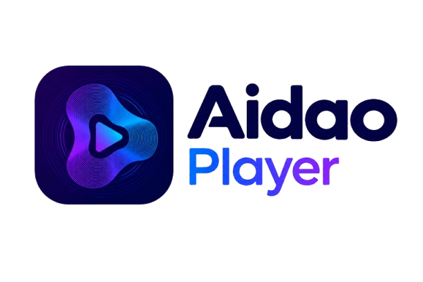

<div align="center">
  
  <h1>Aidao Player</h1>
  <p>A premium, web-based music and video player built with vanilla HTML, CSS, and JavaScript.</p>
  
  [](https://iamsalvation.github.io/aidao-player/)
</div>

---

## 🎧 What is Aidao Player?

Aidao Player is a fully offline-capable Progressive Web App (PWA) that lets you play local music and video files directly in your browser. No servers, no uploads, no accounts. Just drag, drop, and play.

## ✨ Features

- **VLC-Style UI:** A sleek, dark interface with an accent color that adapts to your chosen theme.
- **Audio Visualizer:** A real-time neon frequency visualizer that pulses to the beat of your music.
- **Spinning Vinyl:** Album art spins on a virtual turntable, complete with a center hole.
- **10-Band Equalizer:** Adjust Bass, Mid, and Treble with built-in presets (Rock, Jazz, Bass Boost).
- **Theme Engine:** Choose between VLC (Orange), Spotify (Green), or Cyberpunk (Neon Pink).
- **Smart Library:** Your playlist is automatically saved. Refreshing the page won't lose your songs.
- **PWA Installable:** Install it directly to your desktop or phone home screen like a native app.
- **Theater Mode:** Hides the sidebar and expands the video for a cinematic experience.
- **Keyboard Shortcuts:** Full support for Space (Play/Pause), Arrows (Seek/Volume), N/P (Next/Prev), and Ctrl+F (Search).
- **Drag & Drop:** Drop entire folders of media right into the app.
- **Media Session:** Control playback from your keyboard's media keys, Windows volume flyout, or phone lock screen.

## 🚀 How to Use

1. Visit the **[Live Demo](https://iamsalvation.github.io/aidao-player/)**.
2. Click **"Open folder"** and select your local .mp3 or .mp4 files.
3. Alternatively, drag and drop your files directly into the window.
4. Click play and enjoy!

*Note: Because Aidao runs entirely in your browser, your files never leave your computer. Everything is processed locally.*

## 🛠️ Tech Stack

- **Vanilla JavaScript** (No frameworks, no build tools)
- **Web Audio API** (For the visualizer and equalizer)
- **IndexedDB / LocalStorage** (For the smart library)
- **CSS Variables** (For the dynamic theme engine)
- **Service Workers** (For offline PWA support)
- **jsmediatags** (For reading MP3 ID3 metadata and album art)

## 💻 Run Locally

If you want to run Aidao Player on your own machine:

```ash
# Clone the repository
git clone https://github.com/IamSalvation/aidao-player.git

# Navigate into the folder
cd aidao-player

# Open index.html in your browser
# (Or use VS Code Live Server)
```

## 📝 License

This project is open-source and available under the [MIT License](LICENSE).
